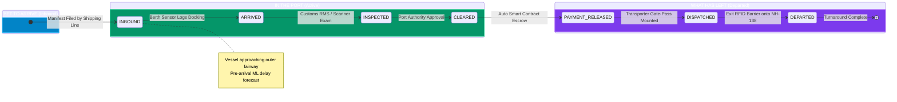

<div align="center">

# ⚓ VOC Port Smart Container Tracker — Thoothukudi
### *Smart Cities Mission & Sagarmala Digital Port Initiative*

[](https://python.org)
[-orange.svg?logo=scikitlearn&logoColor=white)](https://scikit-learn.org)
[](https://ethereum.org)
[-363636.svg?logo=solidity&logoColor=white)](https://soliditylang.org)
[](https://leafletjs.com)
[](LICENSE)

<p align="center">
  <b>A real-time, transparent maritime tracking platform connecting Port Authorities, Customs, Shipping Lines, and Logistics Transporters at V.O. Chidambaranar Port (Thoothukudi).</b>
</p>

[Explore Features](#-key-features) • [Operational Categories](#-3-operational-categories) • [ML Prediction Engine](#-machine-learning-dwell--delay-mitigation) • [Blockchain Architecture](#-blockchain-transparency--smart-contract) • [Quick Start](#-quick-start-in-3-steps) • [API Reference](#-api-endpoints)

---

</div>

## 📌 Executive Overview

**V.O. Chidambaranar Port (Thoothukudi, Tamil Nadu)** is one of India's 12 major ports, processing over **0.87 Million TEUs annually** at an operating berth queue saturation of **~82%**. In traditional port operations:
- Cargo handoffs across stakeholders (Shipping Lines, Port Authority, Customs Commissionerate, Transporters) suffer from **information silos and delayed dispute resolution**.
- High berth occupancy during North-East Monsoon swells (October–December) causes **bottlenecks and unpredicted yard dwell times**.
- Financial escrow releases for port dues traditionally require **manual paperwork and human verification**.

### The Solution
The **VOC Port Smart Container Tracker** delivers an end-to-end digital command center combining three foundational technologies:

```
┌─────────────────────────────────────────────────────────────────────────────┐
│                      VOC PORT SMART CONTAINER TRACKER                        │
└──────────────────────────────────┬──────────────────────────────────────────┘
                                   │
         ┌─────────────────────────┼─────────────────────────┐
         ▼                         ▼                         ▼
   📡 IoT Sensing            ⛓ Blockchain Ledger       🧠 Machine Learning
   RFID Berth Sensors        SHA-256 Hash Chaining     Random Forest (300 Trees)
   Gate Boom Barriers        Role-Gated Permissions    Dwell Time Prediction
   AIS Vessel Radar          Autonomous Smart Escrow   Proactive Delay Mitigation
```

---

## 🌟 Key Features

- **🚢 3 Categorized Operational Views:** Distinct real-time visibility across containers **Yet to Arrive**, **In the Port**, and **What Has Left**.
- **🧠 Predictive Dwell Engine ($R^2 = 0.962$):** Predicts container turnaround hours before the vessel docks, based on cargo category, trade flow, monsoon season, and yard queue.
- **⚡ Proactive Delay Prevention:** Automatically generates actionable operational recommendations (e.g., Direct Port Delivery green channel routing, seafood reefer cold-chain priority) to minimize turnaround times.
- **⛓ Verifiable Blockchain Immutability:** Append-only SHA-256 hash-chained ledger. An interactive hacker-tamper simulator proves mathematical detection if any historical block is altered.
- **📜 Smart Contract with Automated Escrow:** Mirrors rules in Solidity (`contracts/ContainerTracker.sol`). When Customs signs off `CLEARED`, the smart contract **autonomously executes `PAYMENT_RELEASED`** without human delay.
- **🗺 Interactive Thoothukudi GIS Radar:** Leaflet.js harbour map displaying real geographical coordinates across the Gulf of Mannar fairway, Berth VIII (DBGT), Berth IX (PSA SICAL), CFS inspection sheds, and the NH-138 exit corridor.

---

## 📦 3 Operational Categories

The platform organizes every container into three distinct stages:



| Operational Stage | Target Location / Zone | Stakeholder Role | Smart Action / AI Optimization |
| :--- | :--- | :--- | :--- |
| **🚢 Yet to Arrive** | Gulf of Mannar Outer Anchorage | `SHIPPING_LINE` | Advance manifest filed; pre-arrival dwell predicted so yard slots are reserved *before* vessel docking. |
| **🏗 In the Port** | Berth VIII / IX, CFS Examination Yard | `SYSTEM`, `CUSTOMS`, `PORT_AUTHORITY` | RFID dock sensors trigger arrival; customs inspection sign-off; **automatic escrow settlement** upon clearance. |
| **🚚 What Has Left** | VOC Port Gate 1 Plaza $\rightarrow$ NH-138 Expressway | `TRANSPORTER`, `SYSTEM` | Commercial chassis loaded; outer gate sensor logs highway departure to hinterland (Madurai/Tirunelveli/Coimbatore). |

---

## 🧠 Machine Learning Dwell & Delay Mitigation

The prediction engine is powered by a scikit-learn **Random Forest Regressor** calibrated to real-world published statistics of VOC Port operations.

### Holdout Performance Metrics
| Metric | Score | Description |
| :--- | :--- | :--- |
| **MAE (Mean Absolute Error)** | **3.96 hours** | Average difference between predicted and actual container turnaround. |
| **RMSE (Root Mean Square Error)** | **5.14 hours** | Low variance indicating robust handling of congestion spikes. |
| **$R^2$ Score** | **0.962** | **96.2% of dwell variance** explained by the model features. |
| **Holdout Sample** | **20% of 5,000 rows** | Calibrated on realistic VOC Port parameters. |

### Top Feature Importances
```
cat__trade_Export          ████████████████████ 25.1%
num__customs_exam          █████████████████    21.6%
cat__trade_Import          ███████████████      18.4%
num__vessel_queue          ██████               7.8%
cat__cargo_category_Seafood █████                6.5%
cat__cargo_type_Reefer     █████                6.4%
num__month (Monsoon Season)███                  4.0%
```

### Proactive Delay Mitigation Strategies

The AI engine evaluates features in real time to recommend specific operational interventions:

```
  ┌───────────────────────────────┬────────────────────────────────────────────────────────┐
  │ Dwell Time Forecast           │ Proactive Smart Action to Avoid Delays                 │
  ├───────────────────────────────┼────────────────────────────────────────────────────────┤
  │ 🟢 Low Risk (< 32h)           │ ⚡ Direct Port Delivery (DPD) Green Channel Bypass:     │
  │                               │ Pre-approved for instant evacuation (saves ~14h).      │
  │ 🟡 Moderate Risk (32h - 52h)  │ 📋 Dynamic Staging & Advance e-Sanchit Scrutiny:       │
  │                               │ Pre-allocates terminal quick-turnaround bay (saves ~18h)│
  │ 🔴 High Congestion Risk (>52h)│ 🚨 Expedited Customs Fast-Track Escalation:            │
  │                               │ Priority scanning queue & dedicated RTG crane allocated│
  │ 🐟 Frozen Seafood (Reefer)    │ ❄ Cold-Chain Express Priority: Dedicated plug point at  │
  │                               │ Berth IX with zero turnaround wait (saves ~22h).       │
  └───────────────────────────────┴────────────────────────────────────────────────────────┘
```

---

## ⛓ Blockchain Transparency & Smart Contract

### Cryptographic Hash-Chain Ledger
Every container event is recorded as an immutable block:
$$\text{Hash}_i = \text{SHA-256}(\text{Index}_i \parallel \text{Timestamp}_i \parallel \text{Actor}_i \parallel \text{Event}_i \parallel \text{Payload}_i \parallel \text{Hash}_{i-1})$$

```
[ Block #0: GENESIS ] ──► [ Block #1: INBOUND ] ──► [ Block #2: ARRIVED ] ──► [ Block #3: CLEARED ]
  Hash: 3a9f...             PrevHash: 3a9f...         PrevHash: b7c1...         PrevHash: d4e8...
                            Hash: b7c1...             Hash: d4e8...             Hash: f9a2...
```

*If an unauthorized actor alters any block in `runtime/ledger.json`, all subsequent SHA-256 hashes break immediately. Clicking **Verify Chain** or running `/api/verify` pinpoints the exact tampered block index.*

### Solidity Smart Contract (`contracts/ContainerTracker.sol`)
The Python standard library backend strictly mirrors the rules of the deployable Ethereum smart contract:

```solidity
// SPDX-License-Identifier: MIT
pragma solidity ^0.8.24;

contract ContainerTracker {
    enum Status { NONE, INBOUND, ARRIVED, INSPECTED, CLEARED, PAYMENT_RELEASED, DISPATCHED, DEPARTED }

    modifier onlyRole(string memory required) {
        if (keccak256(bytes(roles[msg.sender])) != keccak256(bytes(required)))
            revert AccessDenied(required);
        _;
    }

    // Clearance AUTOMATICALLY triggers payment release without manual delay
    function markCleared(bytes32 cid) external onlyRole("PORT_AUTHORITY") {
        if (shipments[cid].status != Status.INSPECTED)
            revert InvalidTransition(shipments[cid].status, Status.CLEARED);
        
        shipments[cid].status = Status.PAYMENT_RELEASED;
        emit Cleared(cid, msg.sender, uint64(block.timestamp));
        emit PaymentReleased(cid, uint64(block.timestamp)); // Autonomous Escrow
    }
}
```

---

## 🚀 Quick Start (in 3 Steps)

### Step 1: Start the Backend Server
```bash
python backend/app.py
```
> **Zero Heavy Dependencies:** The core backend runs on the Python standard library with no external web framework needed.
> **Live demo feed:** Normal startup advances containers in the existing runtime database every 5 seconds and adds a new inbound manifest periodically. Use `python backend/app.py --no-live-demo` to disable automatic demo events and display only records written to the database by other sources.

### Step 2: Open the Officer Portal or Admin Console
Visit **[http://localhost:5000](http://localhost:5000)** for the plain-language container tracking portal and date-filtered PDF movement reports. The original command dashboard, including operational controls, GIS, ML tools, and ledger verification, remains at **[http://localhost:5000/admin](http://localhost:5000/admin)**.

### Step 3: Optionally Run a Simulated IoT Journey
The backend's live demo feed already advances the shared database. To run a separate, faster full 6-stage journey in another terminal:
```bash
python iot_simulator/simulate.py --fast
```
Or populate a 12-container fleet across all 3 categories at once:
```bash
python iot_simulator/seed_demo.py
```

---

## 🎮 Interactive Dashboard Walkthrough

### 1. Executive KPI Summary Ribbon
Displays real-time counters for:
- **Yet to Arrive:** Inbound approaching vessels with fairway countdowns.
- **Inside VOC Port:** Active containers docked, in yard, or under customs inspection.
- **What Has Left:** Dispatched containers en route via NH-138.
- **Average Predicted Dwell:** Turnaround hours vs VOC Port 36-hour SLA benchmark.
- **Delay Prevention AI:** Cumulative hours saved through proactive interventions.
- **Blockchain Blocks:** Verified blocks with zero integrity failures.

### 2. Operational Category Tabs & Instant Search
- Switch between **🌐 All Containers**, **🚢 Yet to Arrive**, **🏗 In the Port**, and **🚚 What Has Left**.
- Instant search by Container ID (`TUTU...`), Vessel Name, Shipping Line (Maersk, MSC, CMA CGM), or Cargo Category.

### 3. Thoothukudi Harbour GIS Radar
Interactive Leaflet map showing the port layout:
- 🔵 **Outer Anchorage:** Gulf of Mannar fairway approach (Yet to Arrive).
- 🟢 **Berths VIII & IX:** PSA SICAL and DBGT container berths (In Port).
- 🟣 **VOC Port Gate 1:** Exit plaza to NH-138 Expressway (Departed).
- Click **Map View** on any container card to pan directly to its location.

### 4. 1-Click Hacker Tamper Test
In the Blockchain panel:
1. Click **🧨 Run Hacker-Tamper Test**.
2. A simulated unauthorized modification is made to a block copy.
3. The UI flags the cryptographic mismatch with an alert: `TAMPER DETECTED at Block #X: Cryptographic hash broke!`.
4. Click **🔍 Verify Chain** to confirm that the real ledger remains 100% intact.

### 5. ML Delay Optimizer Lab
1. Select trade flow (*Export/Import*), cargo type (*Seafood Reefer, Tuticorin Salt, Granite*), and month (*October Monsoon*).
2. Move the **Berth Queue Saturation Slider** from 55% to 99%.
3. Check the **Risk-Based Customs Exam** box.
4. Click **Calculate Prediction** to view real-time dwell forecasts and tailored AI mitigation strategies.

---

## 🔌 API Endpoints

| Method | Endpoint | Description |
| :--- | :--- | :--- |
| `GET` | `/` | Serves the officer-facing container tracking and reporting portal. |
| `GET` | `/admin` | Serves the interactive operations Command Dashboard. |
| `GET` | `/api/report.pdf?from=YYYY-MM-DD&to=YYYY-MM-DD` | Downloads a PDF of containers with recorded lifecycle events in the selected date range. |
| `GET` | `/api/state` | Returns active shipments, category counts, summary KPIs, and ledger tail. |
| `POST` | `/api/event` | Logs a lifecycle event (`INBOUND`, `ARRIVED`, `INSPECTED`, `CLEARED`, `DISPATCHED`, `DEPARTED`). |
| `POST` | `/api/seed` | Seeds a realistic 12-container fleet across all 3 categories. |
| `GET` | `/api/verify` | Recomputes every SHA-256 hash in the ledger to verify chain integrity. |
| `GET` | `/api/demo-tamper` | Forges a block in a temporary copy to prove tamper detection. |
| `POST` | `/api/predict` | Predicts dwell hours and outputs delay mitigation strategies for custom features. |
| `GET` | `/api/health` | Returns model load status, holdout metrics, and ledger block count. |
| `POST` | `/api/reset` | Resets state and ledger to a fresh Genesis block. |

---

## 📁 Repository Structure

```
voc-chidambaram-port/
├── backend/
│   ├── app.py                  # HTTP server & REST API (port 5000)
│   ├── core.py                 # Ledger, role gating, ML prediction, state machine
│   └── static/
│       └── dashboard.html      # High-fidelity command dashboard (Leaflet GIS)
├── contracts/
│   ├── ContainerTracker.sol    # Solidity smart contract (Sepolia ready)
│   └── HARDHAT.md              # Smart contract deployment guide
├── data/
│   └── voc_port_dwell_dataset.csv # 5,000-row synthetic calibrated dataset
├── docs/
│   └── DATASET.md              # Dataset calibration reference documentation
├── iot_simulator/
│   ├── seed_demo.py            # Seeds demo containers across all 3 categories
│   └── simulate.py             # Real-time 6-stage lifecycle event simulator
├── ml/
│   ├── generate_dataset.py     # Generates VOC-calibrated dwell dataset
│   ├── train_model.py          # Trains Random Forest pipeline
│   └── model/
│       ├── delay_model.joblib  # Serialized pipeline (R² 0.962, MAE 3.96h)
│       ├── feature_spec.json   # Categorical & numeric feature schema
│       └── metrics.json        # Evaluation metrics
├── runtime/
│   ├── ledger.json             # Append-only SHA-256 blockchain ledger
│   └── state.json              # Current active port inventory
└── requirements.txt            # Python dependencies (scikit-learn, pandas, joblib)
```

---

## 🤝 Project Credits & Acknowledgements

- **Initiative:** Smart Cities Mission & Sagarmala Digital Port Programme
- **Port:** V.O. Chidambaranar Port Authority (formerly Tuticorin Port Trust), Tamil Nadu, India
- **Terminals:** PSA SICAL Container Terminal (Berth IX) & DBGT Terminal (Berth VIII)
- **Customs Jurisdiction:** Tuticorin Customs Commissionerate, Custom House, Tuticorin

---

<div align="center">
  <sub>Built with ❤️ for smooth, efficient, and transparent maritime logistics at VOC Port Thoothukudi.</sub>
</div>
